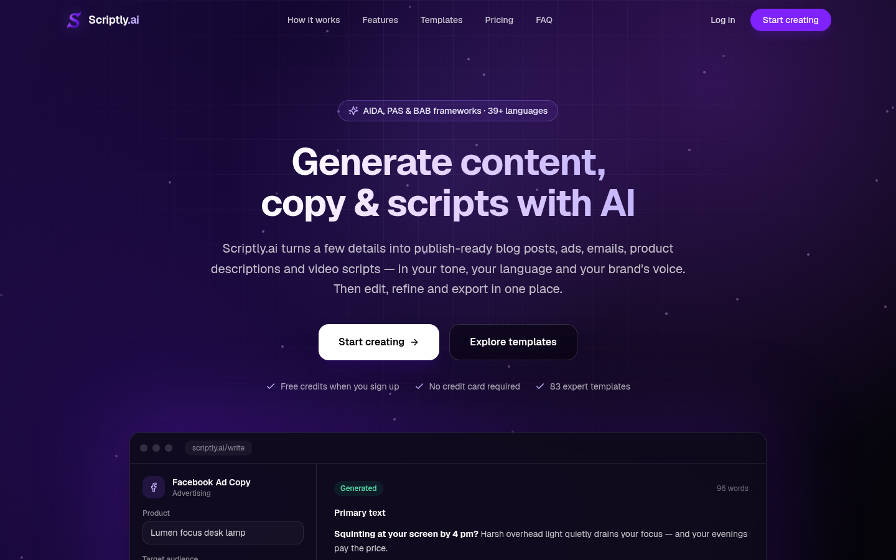
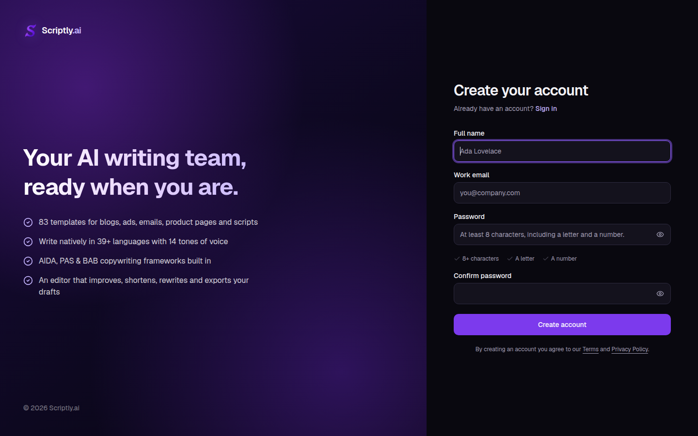
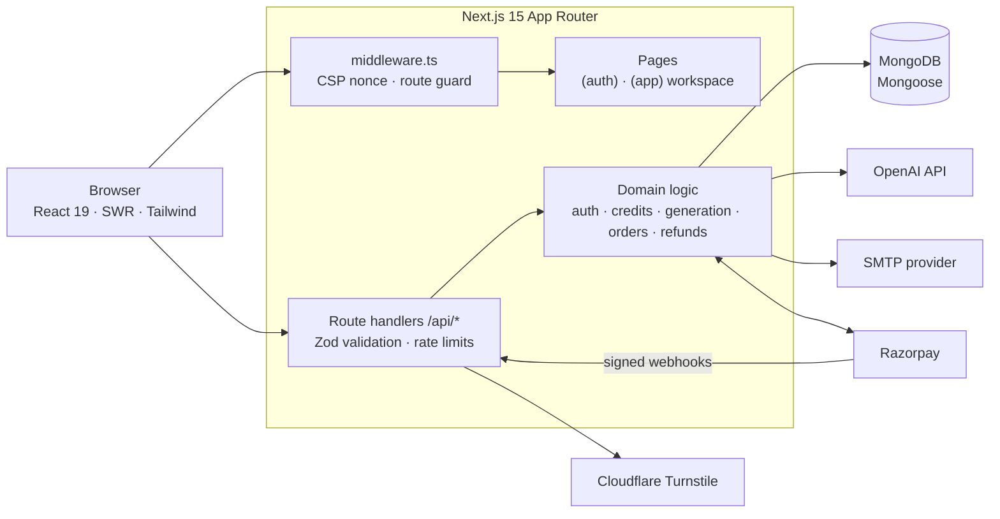
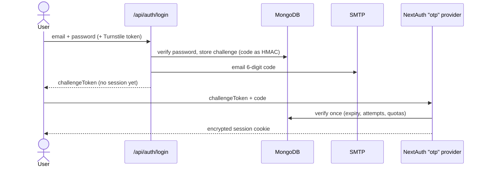
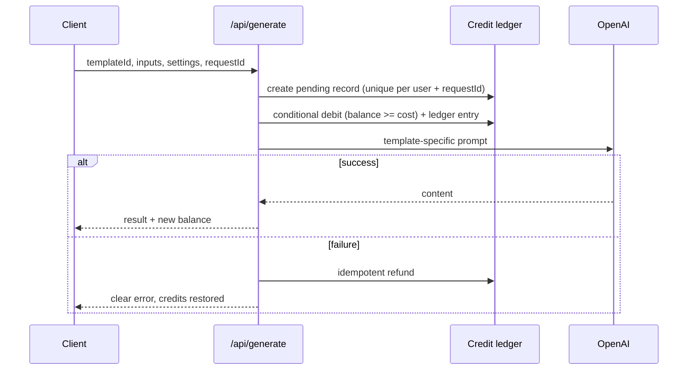

<div align="center">


# Scriptly.ai

**A full-stack AI content-generation SaaS: from a few inputs to publish-ready blog posts, ads, emails and video scripts.**

[](https://nextjs.org/)
[](https://react.dev/)
[](https://www.typescriptlang.org/)
[](https://tailwindcss.com/)
[](https://mongoosejs.com/)
[](https://next-auth.js.org/)
[](https://platform.openai.com/)
[](https://razorpay.com/)
[](https://vitest.dev/)

[Features](#features) · [Screenshots](#screenshots) · [Architecture](#architecture) · [Getting started](#getting-started) · [Testing](#testing) · [Deployment](#deployment) · [Docs](#documentation)

</div>

> **Status:** code-complete for V1. Not yet production-ready: the OpenAI, SMTP, Razorpay and Turnstile integrations
> still need live tests with real credentials ([docs/INTEGRATION_TESTING.md](docs/INTEGRATION_TESTING.md)). All
> automated checks pass. See [PRODUCTION_READINESS.md](PRODUCTION_READINESS.md) for what is verified and what isn't.

---

## Highlights

- **83 templates** across 11 categories, **39 languages**, 14 tones, 9 writing styles, and **AIDA / PAS / BAB**
  copywriting frameworks, with template-specific prompts that stay on the server.
- **Email-based two-step login**: a correct password never creates a session on its own. Accounts are created only
  after the email address is verified.
- **Credit system you can trust**: atomic, ledgered, idempotent server-side accounting. Concurrent requests can't
  overdraw, retries are charged once, and failed generations are refunded automatically.
- **Payments with reconciliation**: Razorpay checkout, signature-verified webhooks, exactly-once crediting, and
  automatic handling of refunds issued in Razorpay.
- **Security built in**: nonce-based Content-Security-Policy, hashed one-time codes, per-recipient email quotas,
  an optional Cloudflare Turnstile bot check, rate limiting, ownership checks on every resource, and immediate session
  revocation.
- **Tested end to end**: 111 unit and integration tests plus 32 end-to-end tests that drive the production build over
  real HTTP, against real MongoDB and a real SMTP server.

## Screenshots

Captured from the production build (`next start`).

| Landing page | Signup |
| --- | --- |
|  |  |

## Features

| Area | What you get |
| --- | --- |
| **AI generation** | 83 templates in 11 categories, each with its own inputs and prompt instructions · 39 languages, written natively rather than translated · 14 tones · 9 styles · 3 creativity levels · length control · AIDA, PAS and BAB · brand voice and extra instructions |
| **Editor** | Markdown editor with preview · AI tools on the whole document or a selection: improve, expand, shorten, rewrite, change tone, fix grammar, continue writing, 3 alternative versions · undo · export to Markdown, text, HTML, Word (.doc) or PDF (print) · autosave with conflict detection and local draft recovery |
| **Workspace** | Dashboard built from real usage data · template library with search, filters and details · documents (search, filter, sort, rename, duplicate, delete) · paginated generation history (view, reopen, regenerate) |
| **Accounts** | Signup with an emailed 6-digit code · two-step login (password, then emailed code) · forgot/reset password · verified email change · password change · sign out everywhere · account deletion · optional Google sign-in |
| **Credits & billing** | Free signup credits · atomic, idempotent accounting with a full ledger · automatic refunds for failed generations · packages stored in MongoDB · Razorpay checkout and webhooks · refund reconciliation |
| **Security** | bcrypt passwords and HMAC-hashed codes · expiring, single-use codes with attempt limits · per-recipient email quotas · optional Turnstile · MongoDB-backed rate limiting · encrypted HttpOnly sessions revoked server-side · ownership and same-origin checks · nonce-based CSP and security headers |

## Architecture



### Sign-in flow: a password alone never creates a session



### Generation and credits: charged once, refunded on failure



### Key design decisions

- **One session system.** NextAuth JWT sessions issued only by a custom `otp` credentials provider. Every API call
  and workspace page re-checks the user and a session version in MongoDB, so revocation is immediate.
- **Correctness through the database.** Conditional atomic updates and unique idempotency keys, with transactions on
  replica sets and compensating writes on standalone MongoDB.
- **Provider interfaces.** `AIProvider` and `PaymentProvider` keep OpenAI and Razorpay swappable and testable.
- **Webhooks as the source of truth.** Fulfilment and refunds are idempotent and safe for retries and out-of-order
  delivery.

## Tech stack

| Layer | Technology |
| --- | --- |
| Framework | Next.js 15 (App Router, route handlers, middleware), React 19, TypeScript |
| UI | Tailwind CSS 4, shadcn/ui on Radix primitives, Lucide icons, Sonner, SWR |
| Data | MongoDB with Mongoose 8 |
| Auth | NextAuth 4 (JWT) + custom email OTP challenges; optional Google OAuth |
| AI | OpenAI Chat Completions behind a provider interface |
| Email / payments / bot check | Nodemailer (SMTP) · Razorpay · Cloudflare Turnstile |
| Validation & tests | Zod (shared client/server) · Vitest (unit, integration, E2E) |

## Project structure

```
app/
  (auth)/            login, signup, forgot-password
  (app)/             workspace: dashboard, write, templates, documents, history, billing, settings
  api/               route handlers: auth, me, generate, refine, documents, history, credits, packages, orders, webhooks
  components/        landing, auth, editor, writer, app shell, shadcn/ui primitives
lib/
  ai/                provider interface, OpenAI provider, prompt builder, template instructions (server-only)
  auth/              NextAuth options, OTP challenges + email quotas, Turnstile, accounts, session guards
  email/ payments/ security/ templates/ client/
  credits.ts generation.ts orders.ts refunds.ts rate-limit.ts zod.ts config.ts db.ts …
models/              Mongoose schemas
middleware.ts        per-request CSP nonce; redirects signed-out visitors
scripts/             seed, credit adjustment, SMTP test email, E2E runner
tests/               unit, integration (MongoDB) and E2E suites + test-only mock servers
docs/                API, database, deployment, live integration tests, launch checklist
```

## Getting started

### Prerequisites

- Node.js **20.9+** (**22.12+** to run the tests) and npm
- MongoDB 6+ (local `mongod`, Docker, or Atlas)
- An OpenAI API key, to generate content
- SMTP credentials (required in production; optional in development)

### Install and run

```bash
git clone https://github.com/Archi-shaw/Scriptly.ai.git
cd Scriptly.ai
npm install
cp .env.example .env.local     # then fill in the values below
npm run db:seed                # indexes + default credit packages
npm run dev                    # http://localhost:3000
```

In development, if `SMTP_HOST` is unset, verification codes are printed to the dev-server console so you can sign up
without an email provider. In production, codes are never logged.

### Environment variables

Every variable is documented in [`.env.example`](.env.example) and, for production, in
[docs/DEPLOYMENT.md](docs/DEPLOYMENT.md#1-environment-variables).

| Variable | Required | Purpose |
| --- | --- | --- |
| `MONGODB_URI` | yes | MongoDB connection string |
| `NEXTAUTH_URL` | yes | Public base URL of the app |
| `NEXTAUTH_SECRET` | yes | Encrypts sessions and keys the OTP hashes (`openssl rand -base64 32`) |
| `OPENAI_API_KEY` | for AI | Without it, generation is disabled with a clear message |
| `OPENAI_MODEL`, `OPENAI_REASONING_EFFORT` | no | Defaults `gpt-6-luna` and `none` |
| `SMTP_HOST`, `SMTP_PORT`, `SMTP_USER`, `SMTP_PASS`, `SMTP_FROM` | production | Verification codes and security notices (TLS required in production) |
| `RAZORPAY_KEY_ID`, `RAZORPAY_KEY_SECRET`, `RAZORPAY_WEBHOOK_SECRET` | no | Enables credit purchases |
| `TURNSTILE_SITE_KEY`, `TURNSTILE_SECRET_KEY` | recommended in production | Bot check on signup, login and password reset (both or neither) |
| `GOOGLE_CLIENT_ID`, `GOOGLE_CLIENT_SECRET` | no | "Continue with Google" |
| `SIGNUP_BONUS_CREDITS`, `NEXT_PUBLIC_SUPPORT_EMAIL`, `CSP_REPORT_URI`, `CSP_REPORT_ONLY` | no | Signup credits (default 25), support address (build-time), CSP reporting |

## Scripts

| Command | What it does |
| --- | --- |
| `npm run dev` | Development server |
| `npm run build` / `npm start` | Production build / serve it |
| `npm run lint` / `npm run typecheck` | ESLint / TypeScript |
| `npm test` | Unit tests; integration tests too when `TEST_MONGODB_URI` is set |
| `npm run test:e2e` | End-to-end tests over HTTP against the production build |
| `npm run db:seed` | Create indexes and default credit packages (`-- --update` to overwrite prices) |
| `npm run credits:grant -- <email> <amount> [reason]` | Ledgered admin credit adjustment |
| `npm run email:test -- <email>` | Send a test email through the configured SMTP server |

## Testing

```bash
npm test                                                                    # unit tests
TEST_MONGODB_URI="mongodb://127.0.0.1:27017/scriptly_test" npm test         # + integration (db name must contain "test")
E2E_MONGODB_URI="mongodb://127.0.0.1:27017/scriptly_e2e" npm run test:e2e   # E2E (db name must contain "e2e"; it is dropped)
```

The E2E runner starts a mock OpenAI server and an SMTP sink, runs `next start`, and exercises the real HTTP API:
signup and login with emailed codes, generation, credits, documents, ownership checks, CSP nonces, payments and
refund webhooks. The mocks in `tests/mocks/` are used only by tests.

| Suite | Result (latest run) |
| --- | --- |
| Unit + integration (MongoDB replica set) | 111 / 111 passing |
| End-to-end (production build) | 32 / 32 passing |
| `npm audit` | 0 vulnerabilities |

## Deployment

Start with [docs/DEPLOYMENT.md](docs/DEPLOYMENT.md), which configures MongoDB, OpenAI, SMTP, Razorpay, Turnstile and
hosting (Vercel or your own Node server). Then run the live checks in
[docs/INTEGRATION_TESTING.md](docs/INTEGRATION_TESTING.md) and sign off
[docs/LAUNCH_CHECKLIST.md](docs/LAUNCH_CHECKLIST.md).

The essentials:

- Run `npm run db:seed` against production before taking traffic. Its unique indexes make payments idempotent.
- Set `NEXTAUTH_URL` to your HTTPS origin.
- Put the app behind a proxy that sets `x-forwarded-for` / `x-real-ip`.
- Allow 120 s for `/api/generate` and `/api/refine`.

## Documentation

| Document | Contents |
| --- | --- |
| [docs/API.md](docs/API.md) | Every endpoint, its auth, payloads and error codes |
| [docs/DATABASE.md](docs/DATABASE.md) | Collections, fields, indexes and invariants |
| [docs/DEPLOYMENT.md](docs/DEPLOYMENT.md) | Production configuration and hosting |
| [docs/INTEGRATION_TESTING.md](docs/INTEGRATION_TESTING.md) | Live tests for OpenAI, SMTP, Razorpay and Turnstile |
| [docs/LAUNCH_CHECKLIST.md](docs/LAUNCH_CHECKLIST.md) | Launch blockers vs deferrable work, runbook, sign-off |
| [PRODUCTION_READINESS.md](PRODUCTION_READINESS.md) | What is verified, not built, known limitations and risks |
| [IMPLEMENTATION_STATUS.md](IMPLEMENTATION_STATUS.md) | What was built and how it was verified |

## Contributing

1. Create a branch: `git checkout -b feature/your-feature`
2. Make your change with tests, then run `npm run lint && npm run typecheck && npm test`
3. Open a pull request
